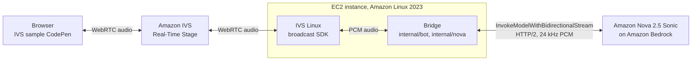

# Build a conversational voice agent on WebRTC with Amazon IVS

## Overview

This sample builds a conversational voice agent with Amazon Nova 2.5 Sonic and connects it to users of a web application through [Amazon Interactive Video Service (Amazon IVS) Real-Time Streaming](https://aws.amazon.com/ivs/features/real-time-streaming/). It has two parts: the IVS sample CodePen in the browser, and a Go service, the bridge, which connect to each other through an IVS Stage. The bridge uses the [IVS real-time streaming Linux broadcast SDK](https://docs.aws.amazon.com/ivs/latest/RealTimeUserGuide/broadcast-linux.html) to join the Stage as a participant. It receives the user's spoken audio, streams it to Nova 2.5 Sonic through the Amazon Bedrock `InvokeModelWithBidirectionalStream` API, and publishes the agent's spoken reply back to the Stage. Amazon IVS handles the real-time media transport, and your application handles the conversation.

## Relationship to main guidance

Standalone. This example shares no code, CDK stacks, or deployed resources with the main guidance. It doesn't use Daily, Pipecat, or the main guidance's ECS service, and you can run and remove it on its own.

## Architecture

The bridge sits between an IVS Stage and Amazon Bedrock:



1. You create a bot token and a user token for the Stage. The bridge joins the Stage with the bot token and publishes one audio stream.
2. A user joins the Stage from the CodePen with the user token and publishes their microphone.
3. The bridge subscribes to that user's audio only. The SDK delivers it as PCM, and the bridge converts it to 24 kHz mono and cuts it into 32 ms frames.
4. The bridge streams the frames to Nova 2.5 Sonic over `InvokeModelWithBidirectionalStream`. While the user is quiet, it sends silent frames.
5. Nova Sonic streams back transcripts and 24 kHz speech. The bridge paces the speech into its published audio stream, and the user hears it through the Stage.
6. If the user talks over the reply, Nova Sonic signals an interruption and the bridge drops the speech it hasn't played yet.
7. When the user leaves, the bridge closes the Nova Sonic session and starts one for the next user who is waiting.

The bridge sends the user's audio at 24 kHz, which Nova Sonic accepts along with 8 and 16 kHz.

The same architecture as an image:


- **Startup.** The bridge reads the bot's token from `BOT_TOKEN_FILE` (or `BOT_TOKEN`), joins the Stage, and publishes one audio stream. It exits with a clear message if the token is malformed, expired, or lacks `PUBLISH`, or if the Stage connection fails, now or later.
- **One user at a time.** When a user joins from the CodePen with their own token ([how to create one](#3-create-the-participant-tokens)), the bot opens a Nova Sonic stream and subscribes to that user's audio only. Others wait in join order.
- **Barge-in.** If the user talks over the assistant, playback stops immediately.
- **Session limit.** The conversation ends when the user leaves. If Nova's stream ends first, for example at the session limit or after about 5 minutes without speech, the bridge starts a fresh one for the same user. See [Stream time limits](#stream-time-limits).

## Repository layout

| Path | What it is |
| --- | --- |
| [src/bridge/](src/bridge/) | Go service: IVS Linux broadcast SDK and AWS SDK for Go v2 |
| [src/bridge/main.go](src/bridge/main.go) | Configuration, startup and shutdown |
| [src/bridge/internal/bot/](src/bridge/internal/bot/) | Bot participant and audio callbacks (cgo) |
| [src/bridge/internal/nova/](src/bridge/internal/nova/) | Nova Sonic session over Bedrock (pure Go) |
| [src/bridge/internal/audio/](src/bridge/internal/audio/) | Resampling, framing, playout, WAV I/O (pure Go) |
| [src/bridge/cmd/nova-check/](src/bridge/cmd/nova-check/) | Tests Nova Sonic on its own (pure Go) |
| [src/bridge/cmd/e2e-probe/](src/bridge/cmd/e2e-probe/) | Headless end-to-end test |
| [infrastructure/](infrastructure/) | IAM policy, setup and run scripts |

The SDK comes from the Go module `github.com/aws/amazon-ivs-realtime-go`, pinned in [src/bridge/go.mod](src/bridge/go.mod). It includes the native library for x86_64 and arm64.

## Setup

The steps below run the sample on an Amazon Linux 2023 EC2 instance. [Where to run it](#where-to-run-it) explains the instance requirements.

### 1. AWS prerequisites

1. **The IVS Stage.** Create it and note its ARN (`arn:aws:ivs:<region>:<account>:stage/<id>`). You need it only to create tokens. The bridge is configured with a token, not the ARN.
2. **Bedrock model access.** In the Bedrock console, enable access to **Amazon Nova 2.5 Sonic**.
3. **The model ID.** Nova 2.5 Sonic is `amazon.nova-2-5-sonic`, which is the default. Set `NOVA_MODEL_ID` only to try another model, such as Nova 2 Sonic (`amazon.nova-2-sonic-v1:0`).
4. **An instance role** with:
   - [infrastructure/iam-policy.json](infrastructure/iam-policy.json), which grants only Nova Sonic. Replace `<region>` in its `Resource` ARN with the Region where you run the bridge. Bedrock authorizes `InvokeModelWithBidirectionalStream` under the `bedrock:InvokeModel` action. The bridge needs no IVS permissions, because you supply its token.
   - The AWS managed policy `AmazonSSMManagedInstanceCore`, for shell access through Session Manager.
5. **An EC2 instance**: AL2023 on a `t4g.small` (arm64) or `t3.small` (x86_64), with the role above and a security group with no inbound rules.

### 2. Install and build on the instance

The bridge gets the [IVS real-time streaming Linux broadcast SDK](https://docs.aws.amazon.com/ivs/latest/RealTimeUserGuide/broadcast-linux.html), version 1.49.0, as a Go module, so there is nothing to download separately. Clone this repository to the instance, then run the setup script from `examples/nova-sonic-webrtc/`:

```bash
./infrastructure/setup-al2023.sh   # checks libcurl and CA certificates, installs Go 1.24 and gcc, builds bridge, e2e-probe and nova-check into src/bridge/bin/
```

The build downloads the SDK module, including its native library, into the Go module cache. The binaries find the library there through an rpath, so build them on the instance that runs them.

### 3. Create the participant tokens

Create tokens with any credentials allowed to call `ivs:CreateParticipantToken` on the Stage, for example from your laptop. The bridge never needs that permission.

```bash
STAGE_ARN=arn:aws:ivs:<region>:<account-id>:stage/<stage-id>   # your Stage's ARN
STAGE_REGION=$(cut -d: -f4 <<< "$STAGE_ARN")   # tokens are created in the Stage's Region
mint() { aws ivs-realtime create-participant-token --region "$STAGE_REGION" --stage-arn "$STAGE_ARN" \
  --capabilities PUBLISH SUBSCRIBE --query participantToken.token --output text "$@"; }

# The bot's token, for the bridge at startup. role=bot marks it as a bot, so another
# bridge never treats it as a user, and the e2e probe finds it by that attribute.
# Give it a duration that covers how long you will run the bridge (minutes; max 20160).
mint --user-id nova-sonic --attributes role=bot --duration 1440 > bot-token

# A user token: paste it into the CodePen. Create one per person or session.
mint --user-id me --duration 60
```

Copy `bot-token` to the instance with `chmod 600`, and create a fresh bot token each time you start the bridge.

### 4. Run the bridge

```bash
export AWS_REGION=<region>   # a Region where Nova 2.5 Sonic is available
BOT_TOKEN_FILE=~/bot-token ./infrastructure/run.sh 2>&1 | tee run.log | grep --line-buffered level=
```

The bridge joins the Stage as the bot. Look for `bot joined the Stage` and then `bridge ready; waiting for users to join the Stage`. If the bot token is bad, it exits and says why. Keep this terminal open: it's where the conversation appears.

The `grep` hides the SDK's verbose WebRTC output, which has no quiet setting, and `tee` keeps everything in `run.log`.

### 5. Join from the CodePen

1. Open the [IVS sample CodePen](https://codepen.io/amazon-ivs/pen/ZEqgrpo) in **full-page or Debug view** (**Change View** → Full Page or Debug Mode). The editor view runs the pen in a nested frame, where the browser may block the camera and microphone.
2. Paste a **user** token for the same Stage as the bot, allow the camera and microphone, and join.
3. Wear headphones, or keep echo cancellation on, so the bot doesn't hear itself through your speakers.
4. Say hello. Your words and Nova's replies appear in the bridge log as `transcript` lines.

The browser needs no access to the instance: both sides meet on the IVS Stage.

## Configuration

All settings are environment variables read by the bridge.

| Variable | Default | Meaning |
| --- | --- | --- |
| `BOT_TOKEN_FILE` | — | File holding the bot's participant token (preferred) |
| `BOT_TOKEN` | — | The bot's participant token, if no file is given. The bridge removes it from its environment after reading it. |
| `NOVA_MODEL_ID` | `amazon.nova-2-5-sonic` | Bedrock model ID (Nova 2.5 Sonic) |
| `AWS_REGION` | — | Bedrock Region for Nova Sonic. Required unless your shared AWS config sets a region. Use a Region where Nova 2.5 Sonic is available. |
| `SYSTEM_PROMPT` | short, friendly assistant | Sent to Nova Sonic at the start of each conversation |
| `VOICE_ID` | `matthew` | Nova Sonic voice, for example `tiffany` or `amy` |
| `SESSION_LIMIT_SECONDS` | `465` | Ends each Nova Sonic stream before Bedrock's 8-minute limit; the bridge then starts a fresh one. Must be less than 480. |

AWS credentials come from the default chain: on EC2, the instance role.

### Stream time limits

Three limits can end a Nova Sonic stream:

| Limit | When it applies | What Bedrock returns | What the bridge does |
| --- | --- | --- | --- |
| Nova Sonic idle timeout | About 295 s without speech from the user. The silent frames the bridge sends while the user is quiet don't count as speech. | `ValidationException` saying gaps between audio bytes must be less than 295 seconds | Logs `nova sonic ended the stream after about 295 s without speech` at Info, ends the conversation with reason `idle_timeout`, and starts a fresh session |
| Bedrock connection limit | 480 s (8 minutes) after the stream opens | `ModelTimeoutException` | Logs `nova sonic stream failed` and starts a fresh session. The bridge's own limit ends each stream first, so you shouldn't see this. |
| `SESSION_LIMIT_SECONDS` | 465 s after the stream opens, by default. The bridge rejects values of 480 or more at startup. | Nothing: the bridge ends the stream itself | Closes the session cleanly, ends the conversation with reason `session_limit`, and starts a fresh session |

A fresh session doesn't carry over the conversation. Nova Sonic starts again with only the system prompt, so it doesn't remember what the user said before. If other users are waiting, they go first, and the user goes to the back of the line.

## Where to run it

Run it on **EC2 with Amazon Linux 2023**. Constraints:

- **Linux only.** The SDK ships `libaws-ivs-realtime.so` for x86_64 and arm64. It needs glibc 2.34 or newer, so it runs on AL2023 or Ubuntu 22.04+, not Amazon Linux 2. It also needs libcurl 7.68 or newer (`libcurl.so.4`) and a CA certificate bundle; AL2023 includes both. Building the bridge needs Go 1.24 or newer with cgo on, which the setup script installs.
- **Capacity.** The bridge runs one conversation at a time, and its work is light. A `t4g.small` (arm64) or `t3.small` (x86_64) is enough; if the bridge stays above about 20% of a vCPU, use a `c7g.medium`.

ECS on EC2 or Fargate also works once you want containers. The bridge has no special host needs beyond outbound UDP and TCP.

## Verifying it works

Work through these from the bottom up. Each level isolates one more part of the system.

### 1. Unit tests (no AWS needed)

```bash
cd src/bridge && go test ./...
```

The tests cover resampling, PCM decoding, framing, playout pacing, barge-in, and the Nova Sonic session against a fake Bedrock stream.

`go test ./internal/...` also runs on macOS. `go test ./...` must run on Linux, because the `bridge` and `e2e-probe` binaries link against the `.so`.

### 2. Nova Sonic alone (Bedrock, no IVS)

The repository includes [question.wav](question.wav), a 16-bit, 24 kHz recording of "What is the capital of France?". From `examples/nova-sonic-webrtc/`, with `AWS_REGION` set and AWS credentials allowed `bedrock:InvokeModel` on the model:

```bash
src/bridge/bin/nova-check -wav question.wav -out reply.wav
```

`nova-check` streams the question to Nova Sonic in real time, exactly as the bridge does, and prints what Nova heard and said. Expect `USER` and `ASSISTANT` lines, `time to first audio: … ms`, a `reply.wav` several seconds long that says "Paris", and `PASS`. If this fails, the problem is the model ID, model access, IAM or region, not IVS. It needs no IVS SDK, so you can also run it on a Mac with `go run ./cmd/nova-check -wav ../../question.wav` from `src/bridge/`.

To ask a different question, record your own 16-bit WAV and pass it with `-wav`. On a Mac:

```bash
say -o my-question.wav --data-format=LEI16@24000 "What's the tallest mountain in the world?"
```

### 3. Headless end-to-end over IVS (no browser)

With `run.sh` running and nobody else on the Stage, put a fresh user token in the environment on the instance, so it stays out of your shell history and process list. `mint` is the helper from [Setup step 3](#3-create-the-participant-tokens). Run it wherever you have IVS credentials, and paste the token at the prompt if that's not the instance.

```bash
read -rs IVS_PARTICIPANT_TOKEN && export IVS_PARTICIPANT_TOKEN   # paste the output of: mint --user-id e2e-probe
src/bridge/bin/e2e-probe -wav question.wav -out reply.wav
```

The probe stands in for the browser. It joins the Stage with the user token using the Linux broadcast SDK and waits for audio from the `role=bot` participant. Then it waits 2 s (`-settle`) for the bot to subscribe to it. After that it:

- speaks the WAV in real time;
- records the bot's reply as a browser would hear it.

It **passes** if at least 1 s of audible reply arrives within 30 s, and it reports the time to first audio. It exits non-zero on failure, so you can use it as a smoke test after each deploy. Transcripts are in the bridge log, as `transcript` lines tagged with the probe's participant ID.

### 4. Manual test with the CodePen

| Check | Expect |
| --- | --- |
| Join from the pen with a user token | The bridge logs `conversation started user=<id>`, then `receiving user audio user=<id>`. |
| Ask a question | The bridge logs `transcript role=USER text=…` and `transcript role=ASSISTANT text=…`, then `time to first audio ms=…`. You hear the reply in the pen. |
| Talk over the reply | Playback stops within about 300 ms. The bridge logs `barge-in: flushed assistant audio`, and Nova answers the new question. |
| Leave the Stage in the pen | `conversation ended reason=user_left`. The bot stays on the Stage, ready for the next user. |
| Join from a second pen while the first is talking | `user waiting; bot is busy`. When the first user leaves, the bot starts talking with the second. |

### 5. What to watch in the logs

Everything is in the bridge's log, tagged with `user=<participant ID>`:

- `bot joined the Stage bot=…` at startup.
- `conversation started`, then `receiving user audio` when the user's audio arrives.
- `transcript role=USER text=…` and `transcript role=ASSISTANT text=…` for each turn.
- `time to first audio ms=…`: from the user's transcribed words to the first assistant audio at the bridge.
- `barge-in: flushed assistant audio ms=…`: how much unplayed speech was dropped.
- `nova sonic stream failed err="<ErrorCode>: <message>"` if Bedrock rejects or drops the stream.
- `nova sonic ended the stream after about 295 s without speech`, then `conversation ended reason=idle_timeout`, when the user stays quiet. A fresh session follows.
- `audio stats` (every 10 s during a conversation). The first three counters follow the audio from end to end, so the first one that stops growing shows where it stops:
  - `userBuffersReceived`: buffers of the user's audio from IVS.
  - `framesSentToNova`: 32 ms frames sent to Nova Sonic, including keep-alive silence.
  - `novaAudioReceivedMs`: Nova's speech received back.
  - `userBuffersDropped` and `novaFramesDropped` should stay at 0.
  - `playoutPushErrors` should stay at 0.
  - `playoutSilentSec` grows whenever the assistant isn't talking; that's normal.

## Cost

You are responsible for the cost of the AWS services used while running this example.

Estimate for `us-east-1`, checked on 2026-11-19 against the public pricing pages linked below. It assumes the bridge runs all month (730 hours) and handles 100 conversations of 5 minutes each (500 minutes, about 8.3 hours), with the user's camera on in the CodePen.

| Item | Basis | Monthly |
| --- | --- | --- |
| [Amazon Nova 2.5 Sonic](https://aws.amazon.com/bedrock/pricing/) | Speech input and output tokens for 500 minutes of conversation, at the rates on the Amazon Nova tab | Usage-based, see the pricing page |
| [Amazon IVS Real-Time Streaming](https://aws.amazon.com/ivs/pricing/), bot participant | Audio only, on the Stage all month: $0.0072 per participant-hour x 730 hours | $5.26 |
| Amazon IVS Real-Time Streaming, users | Camera on, so the standard rate: $0.0720 per participant-hour x 8.3 hours | $0.60 |
| [EC2 `t4g.small`](https://aws.amazon.com/ec2/instance-types/t4/), always on | Free for up to 750 hours a month until 2026-12-31 under the t4g.small free trial. After that, or for a `t3.small`, use the [On-Demand rate](https://aws.amazon.com/ec2/pricing/on-demand/). | $0 until 2026-12-31 |
| [Amazon EBS](https://aws.amazon.com/ebs/pricing/) root volume | 8 GB gp3, the AL2023 default | Under $1 |
| **Total** | | **About $6 plus Nova 2.5 Sonic usage, until the t4g.small free trial ends** |

Nova 2.5 Sonic usage and, after the free trial, the always-on instance are the main costs. The bot participant bills for every hour it's on the Stage, even with no one talking to it. New AWS accounts also get 20 IVS participant-hours a month free for the first 12 months.

To cut cost, stop the bridge and the instance when you aren't testing.

## Cleanup

1. **Stop the bridge.** Press Ctrl+C in the terminal running `run.sh`. The bridge ends any conversation and leaves the Stage.
2. **Remove the token and log files.** On the instance, in `examples/nova-sonic-webrtc/`, delete the bot token and the log, along with any replies the tests wrote:

   ```bash
   rm -f ~/bot-token run.log reply.wav
   ```

   Also delete the `bot-token` file on the machine where you created it.
3. **Terminate the instance** and delete its security group:

   ```bash
   aws ec2 terminate-instances --instance-ids <instance-id>
   aws ec2 wait instance-terminated --instance-ids <instance-id>
   aws ec2 delete-security-group --group-id <security-group-id>
   ```

4. **Delete the instance role.** Remove it from its instance profile, remove its policies, then delete it:

   ```bash
   aws iam remove-role-from-instance-profile --instance-profile-name <profile-name> --role-name <role-name>
   aws iam delete-instance-profile --instance-profile-name <profile-name>
   aws iam detach-role-policy --role-name <role-name> --policy-arn arn:aws:iam::aws:policy/AmazonSSMManagedInstanceCore
   aws iam delete-role-policy --role-name <role-name> --policy-name <policy-name>   # iam-policy.json, if attached inline
   aws iam delete-role --role-name <role-name>
   ```

   If you attached `iam-policy.json` as a customer managed policy, detach it with `aws iam detach-role-policy` and delete it with `aws iam delete-policy` instead.
5. **Delete the Stage.** This also ends any participant tokens still outstanding for it:

   ```bash
   aws ivs-realtime delete-stage --region "$STAGE_REGION" --arn "$STAGE_ARN"
   ```

## Security

- **The bridge opens no network listener.** It connects out to the IVS Stage and to Bedrock. The instance has no inbound security-group rules. Use SSM Session Manager, which IAM authenticates, for shell access.
- **Participant tokens are the access control.** Anyone holding a valid token for the Stage can join and talk with the bot, and hear whatever it says to anyone on the Stage. Keep user tokens short-lived and give them only to the people meant to use the bot.
- **The CodePen is a public page** hosted on codepen.io, running IVS's sample code in the user's browser. Paste only short-lived user tokens into it, never the bot token.
- **The bot token** is read once at startup from a file (preferred; keep it `chmod 600`) or from `BOT_TOKEN`, which the bridge then removes from its environment. It is never logged. The bridge warns at startup if other users can read the file.
- **AWS credentials** come from the instance role. Nothing is stored in files.
- **Least privilege.** The instance's IAM policy allows only `bedrock:InvokeModel` on the one Nova model. Tokens are created wherever you run the CLI.
- **Transcripts are in the bridge log.** Treat the log as you would the conversation itself.

## Notices

Security and compliance are a [shared responsibility](https://aws.amazon.com/compliance/shared-responsibility-model/) between AWS and the customer. This example is a starting point for evaluation, not a production deployment. Review and harden it before using it with real users or data.

*Customers are responsible for making their own independent assessment of the information in this Guidance. This Guidance: (a) is for informational purposes only, (b) represents AWS current product offerings and practices, which are subject to change without notice, and (c) does not create any commitments or assurances from AWS and its affiliates, suppliers or licensors. AWS products or services are provided "as is" without warranties, representations, or conditions of any kind, whether express or implied. AWS responsibilities and liabilities to its customers are controlled by AWS agreements, and this Guidance is not part of, nor does it modify, any agreement between AWS and its customers.*
