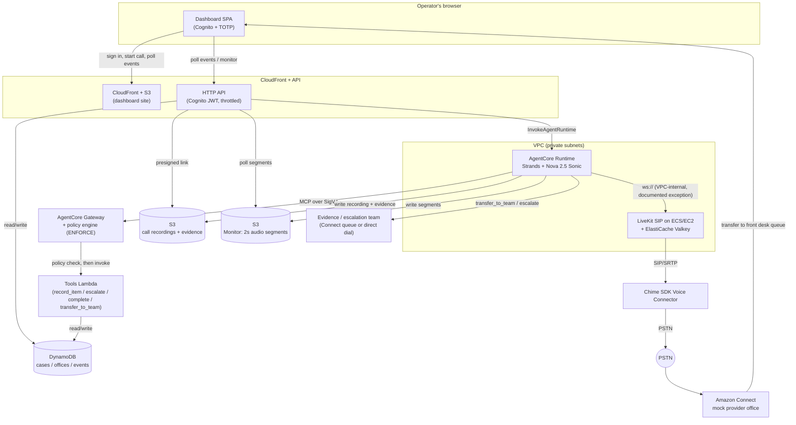
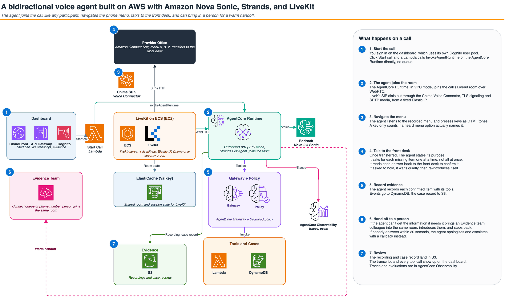
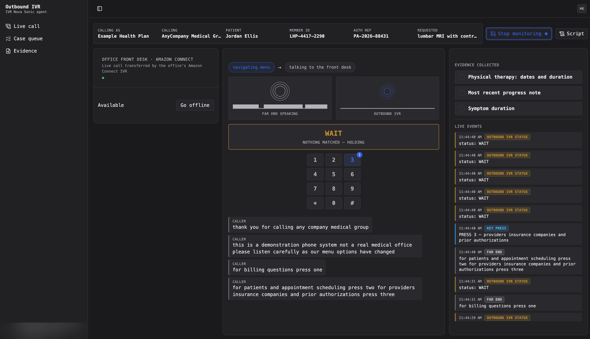
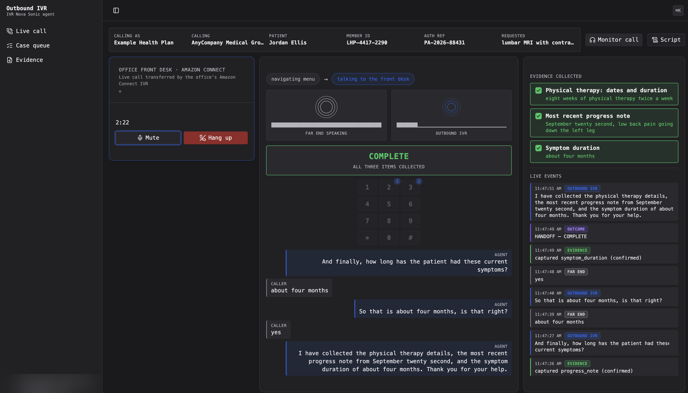

# Outbound IVR Automation

## Overview

Outbound IVR Automation places outbound phone calls on behalf of a caller: it dials a
provider's office, presses touch-tone keys to get through the phone menu (IVR), talks
to whoever answers, collects a short list of missing information for a case, confirms
it back, and hands off to a human when it gets stuck. It is built for teams evaluating
a voice agent on Strands Agents and Amazon Nova Sonic that has to drive a real outbound
call end to end, not just answer inbound ones, and it demonstrates the full chain: a
Bedrock AgentCore Runtime agent, self-hosted LiveKit SIP on ECS, an Amazon Chime SDK
Voice Connector to the PSTN, an AgentCore Gateway with a policy engine in front of the
agent's tools, a Cognito-protected dashboard to watch and listen in on calls, and a
mock Amazon Connect "provider office" to call so the whole thing can be exercised with
no real phone numbers or real patient data. All data in this example is synthetic.

## Relationship to main guidance

Standalone. This example shares no code, no CDK stacks, and no deployed resources with
the main guidance; it has its own `src/`, `infrastructure/`, and `tests/` and can be
deployed and torn down independently.

## Architecture



The same architecture with AWS service icons, and the seven steps of a call ([draw.io source](docs/diagrams/outbound-ivr-architecture.drawio)):



1. An operator signs in to the Cognito-protected dashboard (CloudFront + S3) and picks
   a seeded case.
2. The dashboard's HTTP API invokes the AgentCore Runtime, which places an outbound
   call: Strands on Nova 2.5 Sonic drives the self-hosted LiveKit SIP transport on ECS,
   which bridges through the Chime SDK Voice Connector onto the PSTN.
3. The call reaches the Amazon Connect mock provider office, whose IVR flow transfers it
   to a front-desk queue; a human (the dashboard's embedded Connect CCP) answers and
   plays the front desk.
4. The agent navigates the menu by DTMF, then talks to the front desk, calling tools
   (`record_item`, `escalate`, `complete`, `transfer_to_team`) through the AgentCore
   Gateway. Every tool call is checked by the Gateway's policy engine (Dogwood by
   default, Cedar as an option) before it reaches the tools Lambda, which reads and
   writes the cases/offices/events tables in DynamoDB.
5. If the front desk cannot help, the agent either escalates (ends the call, logs a
   follow-up) or calls `transfer_to_team` to bring a human colleague onto the live call,
   either by direct dial or through a Connect handoff-code queue.
6. Once the call ends, the recording and the evidence record (items collected, outcome,
   transcript) land in S3 and DynamoDB; the dashboard reads both.
7. While the call is live, the Runtime also writes 2-second audio segments to a separate
   S3 bucket (the Monitor). The dashboard polls them through the same Cognito-protected
   API (there is no separate public endpoint and no WebSocket), so an operator can
   listen in, lagging the live call by about 3-6 seconds.

### Security notes

- LiveKit's signaling (7880) and WebRTC ports are reachable only from inside the VPC
  CIDR: no public dashboard, no public softphone. An operator reaches them only through
  an SSM port-forward if needed.
- SIP signaling (5061) and SRTP media to the LiveKit host are restricted to the Chime
  SDK Voice Connector's own published CIDR for the Region, not open to the internet.
- The dashboard requires Cognito sign-in plus mandatory TOTP (`cognito.Mfa.REQUIRED`,
  software token only, no SMS); there is no self sign-up.
- The dashboard's HTTP API has a Cognito JWT authorizer on every route (no route can
  opt out) and is throttled at the stage level, with a lower, separate throttle on the
  one route that starts a billable call.
- Data at rest (DynamoDB tables, the artifacts bucket, the Monitor bucket, the
  ElastiCache cache) is encrypted with customer-managed KMS keys.
- The Gateway's policy engine runs in `ENFORCE` mode: a tool call the policy does not
  explicitly allow is denied, not merely logged.
- Documented exception: the AgentCore Runtime talks to the LiveKit host over plain
  `ws://`, not `wss://`. This is intentional for this example: both ends are private
  subnets in the same VPC, the hop never leaves the VPC, and call audio itself is
  WebRTC (DTLS-SRTP, always encrypted) regardless. A production deployment should put
  TLS in front of LiveKit's signaling port.

### Compliance

This example uses synthetic data only: the patient, member ID, authorization reference,
and provider office in the demo case are made up. It is not built or reviewed for real
patient data. Adapting it to protected health information (PHI), including real call
recordings and transcripts, requires using only HIPAA-eligible AWS services under a
Business Associate Addendum (BAA) with AWS, plus your own HIPAA controls and review.
Under the [shared responsibility model](https://aws.amazon.com/compliance/shared-responsibility-model/),
that compliance is the customer's responsibility. See
[HIPAA compliance on AWS](https://aws.amazon.com/compliance/hipaa-compliance/).

## Prerequisites

- Python 3.12 (3.13 is not supported; see `pyproject.toml`'s `requires-python`).
- [uv](https://docs.astral.sh/uv/) (any recent release; this example pins its own
  dependencies in `uv.lock`).
- Node.js and npm for the dashboard build (`src/dashboard`, React 19 + Vite 8).
- AWS CDK CLI (the example's own `aws-cdk-lib==2.273.0` is used at synth time through
  `uv run cdk`; a separately installed global `cdk` CLI of a compatible major version
  also works).
- [finch](https://github.com/runfinch/finch) for container builds: this example sets
  `CDK_DOCKER=finch`, not Docker.
- AWS CLI v2, configured with a profile that has credentials for the target account
  (`aws configure --profile <name>`, then `export AWS_PROFILE=<name>`).
- An AWS account, CDK-bootstrapped in the target Region (`cdk bootstrap
  aws://<account>/<region>`).
- A Region where Amazon Nova 2.5 Sonic, Bedrock AgentCore, and the Chime SDK Voice
  Connector are all available. This example is developed and tested in `us-east-1`.
- Model access to `amazon.nova-2-5-sonic` granted in the Bedrock console for that
  Region (Bedrock model access is opt-in per account/Region).
- Quota headroom for: one Amazon Connect instance (`OutboundIvrOfficeStack`'s mock
  office, which also holds the evidence team's queue), one Chime SDK Voice Connector,
  two Elastic IPs, and two claimed Connect phone numbers (the mock office's DID and
  the evidence team's DID). Check Elastic IPs first: the default quota is 5 per Region.
- A Chime SDK phone number for outbound caller ID. Chime rejects outbound calls whose
  caller ID is not a number associated with the Voice Connector, and there is no
  CloudFormation resource for ordering one, so order it once before deploying:

  ```bash
  aws chime-sdk-voice search-available-phone-numbers --country US --state NY \
    --phone-number-type Local --max-results 5 --region "$OUTBOUND_IVR_REGION"
  aws chime-sdk-voice create-phone-number-order --product-type VoiceConnector \
    --e164-phone-numbers <one of the numbers above> --region "$OUTBOUND_IVR_REGION"
  ```

  Put it in `.env` as `CALLER_ID_NUMBER`. `OutboundIvrVoiceStack` associates it with
  its own Voice Connector (never by force, so a number already used by another
  connector is left alone) and releases it again on `cdk destroy`.
- **This example places real PSTN calls and claims real phone numbers that cost money
  to hold.** Only ever point `FRONT_DESK_NUMBER`/`CALLER_ID_NUMBER` at numbers you own
  or have explicit permission to call, never a real third party's number. Claimed
  numbers bill per month whether or not they are used; see "Cost" below.

## Deploy

All commands run from this folder (`examples/outbound-ivr-automation/`).

```bash
# Tools and credentials
export AWS_PROFILE=<your-profile>
export AWS_REGION=us-east-1          # local/non-deployed use only, see .env.example
export CDK_DOCKER=finch

# One-time: bootstrap CDK in the target account/Region, if not already done
cdk bootstrap aws://<account-id>/us-east-1

# Install the Python dependencies (uv manages its own virtualenv)
uv sync --all-extras

# Configure the deployment
cp .env.example .env
```

Edit `.env` (synthetic values only, never commit a real phone number, email, or
account ID):

| Key | Meaning |
|---|---|
| `OUTBOUND_IVR_ACCOUNT_ID` | The 12-digit account to deploy into. Required; there is no fallback default. |
| `OUTBOUND_IVR_REGION` | The Region to deploy into, e.g. `us-east-1`. Required. |
| `FRONT_DESK_NUMBER` | The phone that plays the mock office's front desk, e.g. `+15555550100`. Must be a number you can answer. |
| `AGENT_EMAIL` | Shared login email for the front-desk and escalation Connect agent users, e.g. `you@example.com`. Never a real address in source control. |
| `CALLER_ID_NUMBER` | The Chime SDK number you ordered (see Prerequisites), presented as outbound caller ID. Required: Chime rejects outbound calls without it. |
| `ALERT_EMAIL` (optional) | Where CloudWatch alarms email; AWS sends one confirmation link that must be clicked once. |
| `EVIDENCE_MODE` (optional) | `direct` dials the evidence number straight into the call; `connect` (default) uses a Connect handoff-code queue. |
| `MOCK_PROVIDER_FLOW_ID` (optional) | Only needed for `deploy_flow.sh`'s fast, CloudFormation-bypassing IVR-flow push. |

Then deploy, in order:

```bash
# 1. The mock provider office (its own Connect instance, front desk, claimed DID).
#    One-time: this stack is long-lived and must never be torn down by the steps below.
infrastructure/scripts/deploy_office.sh

# 2. The Chime SDK Voice Connector + Elastic IP pool, then the agent itself
#    (network, LiveKit on ECS, Gateway, AgentCore Runtime, data, Monitor, dashboard, ops).
infrastructure/scripts/deploy.sh
```

Each script prints a confirmation prompt (pass `--yes` to skip it) and refuses to run
against the wrong account or an unbootstrapped Region. `deploy.sh synth` and
`deploy_office.sh synth` synthesize without deploying anything.

One-time steps after the first deploy:

```bash
# Create a dashboard sign-in for yourself (Cognito admin-created, no self sign-up).
# Both values below are printed in deploy.sh's "Outputs:" for OutboundIvrStack,
# and can be re-fetched any time with:
#   aws cloudformation describe-stacks --stack-name OutboundIvrStack \
#     --query "Stacks[0].Outputs" --region "$OUTBOUND_IVR_REGION"
aws cognito-idp admin-create-user --user-pool-id <DashboardUserPoolId output> \
  --username you@example.com \
  --user-attributes Name=email,Value=you@example.com --region "$OUTBOUND_IVR_REGION"
# Sign in once at the <DashboardUrl output> CloudFront URL to set a password and enroll TOTP.

# Load the demo case and office into DynamoDB
uv run python infrastructure/scripts/seed_cases.py
```

## Try it

1. **Sign in.** Open the `DashboardUrl` from `OutboundIvrStack`'s deploy output and
   sign in with the Cognito user created above: email + password, then a TOTP code
   from an authenticator app on first sign-in.
2. **Pick a case.** The landing page lists seeded cases. Pick the demo case.
3. **Start the call.** The agent dials the mock office through the deployed trunk; the
   live-call page polls the events table and shows menu navigation (DTMF presses) as
   it happens.
4. **Answer as the front desk.** The office's Connect flow transfers the call to the
   front-desk queue, which rings the dashboard's embedded Contact Control Panel. Sign
   that in once as `outbound-ivr-front-desk` and set yourself Available (its password
   is in Secrets Manager: `aws secretsmanager get-secret-value --secret-id
   outbound-ivr/front-desk-agent-password --query SecretString --output text`). Play the
   front desk: give the requested items when asked, confirm each read-back, or push
   back to see the agent escalate or ask for a colleague.
5. **Watch and listen in.** "Monitor call" is always on (no flag or CIDR needed) and
   polls mixed call audio and speaking-indicator levels through the same
   Cognito-protected API, lagging the live call by about 3-6 seconds.
6. **Review the evidence.** Once the agent hangs up, open the case's evidence page:
   the items collected, the final outcome, and the recording (a presigned S3 link).

Success looks like: the case moves from `pending` to a final outcome
(`complete`/`escalated`/`handed_off`), the evidence page shows a transcript and a
playable recording, and the events table shows the full `dtmf`/`heard`/`said`/`tool`
sequence for the call.

While the agent navigates the office's menu: the transcript of the menu prompts, the
key it pressed (3, for providers and prior authorizations), and the live event stream,
with Monitor on.



After the front desk answers: all three requested items collected and confirmed, and
the call's outcome recorded.



## Cost

Estimate for `us-east-1`, priced 2026-11-06 (AWS Price List API), assuming **100 calls
a month, 5 minutes each (500 call-minutes/month)** plus the infrastructure running
continuously (730 hours/month). Real cost depends heavily on call volume and how much
of the month the stacks are left deployed.

| Item | Basis | Monthly |
|---|---|---|
| EC2 `t3.small` (LiveKit host, always on) | $0.0208/hr x 730 hr | $15.18 |
| VPC interface endpoints (7: Secrets Manager, ECR x2, Bedrock Runtime, CloudWatch Logs, AgentCore Gateway, X-Ray; each in one subnet, no NAT) | $0.01/hr x 7 x 730 hr | $51.10 |
| Elastic IPs (2, one in use by the LiveKit host, one held in reserve) | $0.005/hr x 2 x 730 hr | $7.30 |
| ElastiCache Serverless (Valkey, LiveKit's state store) | low data volume + ECPUs at demo scale | ~$3 |
| KMS customer-managed keys (data, cache) | $1/key/month x 2 | $2.00 |
| Secrets Manager secrets (Voice Connector credentials, LiveKit API secret, cache AUTH token, front-desk password) | ~$0.40/secret/month x 4 | $1.60 |
| Claimed phone numbers (mock office DID + evidence-team DID) | ~$1/number-month x 2 | $2.00 |
| Chime SDK caller-ID number | ~$1/number-month x 1 | $1.00 |
| CloudWatch (Container Insights, log groups, alarms) | demo-scale log volume | ~$8 |
| S3 + CloudFront + DynamoDB (on-demand) + Cognito | all well under free-tier/low-volume pricing at this scale | ~$2 |
| **Always-on subtotal** | | **~$93** |
| Amazon Nova 2.5 Sonic tokens | ~750 speech-input + 750 speech-output tokens/min (assumption) x 500 min: $0.003/1k in + $0.012/1k out, plus a small text-token share | ~$6 |
| AgentCore Runtime vCPU/memory | ~1 vCPU + 2 GB for 500 min: $0.1276/vCPU-hr + $0.0169/GB-hr | ~$1.35 |
| AgentCore Gateway tool invocations | ~500 calls x 5 tool calls x $0.000005 | <$0.01 |
| Chime SDK Voice Connector, outbound US minutes | $0.0048/min x 500 min | $2.40 |
| Amazon Connect end-customer minutes (front-desk/queue leg) | $0.018/min x ~300 min (front-desk portion) | $5.40 |
| Lambda + API Gateway (tools, dashboard API, polling) | low request volume | ~$1 |
| **Per-use subtotal (100 calls/month)** | | **~$16** |
| **Total** | | **~$109/month** |

The two biggest drivers are the seven **VPC interface endpoints** (about half the
total, and the same cost whether the example handles one call or a thousand) and the
**EC2 LiveKit host**, together over 60% of the bill: both are always-on infrastructure
that gets paid for even while idle. **Elastic IPs** are the next largest fixed cost.

To cut cost: tear down `OutboundIvrStack` (`infrastructure/scripts/cleanup.sh`, without
the two long-lived stacks) whenever you are not actively testing. That removes the EC2
host, the interface endpoints, the Elastic IPs, and ElastiCache entirely, leaving only
the two claimed phone numbers (~$2-4/month) and the Chime Voice Connector's own EIP
pool running. Lower `evaluationSamplingPercentage` (CDK context, default 100) if you
don't need every call scored by the six online LLM-judge evaluators: each point of
sampling is a Bedrock invocation per evaluator per call.

## Cleanup

```bash
# Dry run: prints exactly what would be removed, deletes nothing
infrastructure/scripts/cleanup.sh

# Actually tear everything down
infrastructure/scripts/cleanup.sh --yes
```

`cleanup.sh` reads the same `.env` the deploy scripts use (`OUTBOUND_IVR_ACCOUNT_ID`,
`OUTBOUND_IVR_REGION`, `FRONT_DESK_NUMBER`, `AGENT_EMAIL`, and the same optionals), so
its own `cdk destroy` synth pass matches what was actually deployed. It:

1. Empties the two S3 buckets that are `DESTROY` with no auto-delete by design (the
   artifacts bucket and the Monitor bucket, both hold evidence/audio nobody should
   lose to an accidental auto-delete), handling every object version and delete marker.
2. Destroys the stacks in reverse dependency order: `OutboundIvrStack`, then
   `OutboundIvrOfficeStack`, then `OutboundIvrVoiceStack`, including the Chime Voice
   Connector, its Elastic IPs, and both claimed phone numbers.

Expect the first run to stop at `OutboundIvrStack`. When the AgentCore Runtime is
deleted, its VPC network interfaces (interface type `agentic_ai`) keep its security
group in use for a while: AgentCore removes them up to 8 hours later, and they cannot
be deleted by hand. The script detects this, says so, and leaves the office and voice
stacks in place (the LiveKit host still holds the voice stack's Elastic IP). Run
`cleanup.sh --yes` again later; it picks up where it stopped.

It always prints a "what this script cannot remove" section with the exact commands
for the handful of things `cdk destroy` does not reach:

- Implicit CloudWatch log groups for Lambda functions that have no explicit
  `logs.LogGroup` (the Chime/Connect custom-resource handler Lambdas).
- AgentCore's own managed log groups under `/aws/bedrock-agentcore/...`.
- The Chime SDK caller-ID number you ordered. Destroying the voice stack only
  releases it from the Voice Connector; delete it from your inventory with
  `aws chime-sdk-voice delete-phone-number --phone-number-id <+1 number>`.
- A claimed Connect phone number that failed to auto-release (rare; normally
  `connect.CfnPhoneNumber` releases on delete with no `RETAIN`).
- The CDK bootstrap asset bucket (`cdk-hnb659fds-assets-<account>-<region>`), which is
  shared across every CDK app in the account/Region and is never touched by this
  example's own `cdk destroy`.

## Troubleshooting

| Symptom | Likely cause | Fix |
|---|---|---|
| A tool call is denied ("front desk refuses to record an item it was never asked to collect") | The Gateway's policy engine (`ENFORCE` mode) rejected the call: `record_item` for a key not on the case's missing-item list, `complete` before every item is recorded, or `transfer_to_team` more than once per call. | This is usually correct behavior; check `infrastructure/policies/dogwood/*.dw` (or the Cedar equivalent) against the case data. If it's a genuine false deny, check the Gateway's CloudWatch Logs for the exact policy decision. |
| Call connects but goes silent, or the far end hears nothing | SIP media (SRTP) timeout, or the far end actually hung up without a clean BYE through the Voice Connector. | Check the LiveKit host's own CloudWatch Logs and ECS task status first; a `participant_disconnected` event in the events table after 15 seconds of no RTP is the real hangup signal in this example. |
| `deploy.sh` fails with "OutboundIvrOfficeStack has not been deployed yet" | `OutboundIvrStack` reads the office's Connect instance id, arn, number, and queue arn from SSM at deploy time; those parameters only exist once `deploy_office.sh` has run. | Run `infrastructure/scripts/deploy_office.sh` first, then retry. |
| Connect IVR flow doesn't reflect a recent edit | `infrastructure/connect/flows/` content only gets pushed by a `deploy_office.sh` redeploy, or `deploy_flow.sh`'s faster direct push. | Re-run `deploy_office.sh`, or set `MOCK_PROVIDER_FLOW_ID` in `.env` and run `deploy_flow.sh` for a CloudFormation-bypassing push. |
| Can't sign in to the dashboard, or TOTP never prompts | No Cognito user exists yet, or MFA enrollment was skipped. | Create the user with `aws cognito-idp admin-create-user` (see "Deploy"); sign-in is mandatory TOTP (`cognito.Mfa.REQUIRED`), so the first sign-in always asks for enrollment. |
| "Monitor call" shows nothing, or returns `404 monitor not enabled` | Either the call isn't live yet, or `OUTBOUND_IVR_MONITOR_BUCKET` is unset on the dashboard API Lambda for this deploy (the Monitor nested stack wasn't built). | Confirm the call is actually in progress; otherwise check the API Lambda's environment variables and redeploy `OutboundIvrStack` if Monitor is genuinely missing. Listen-in audio always lags the live call by 3-6 seconds; that is expected, not a failure. |
| Synth or deploy fails with a Region/model access error | `amazon.nova-2-5-sonic` is not enabled for the account in that Region, or the Region doesn't support Bedrock AgentCore or the Chime SDK Voice Connector. | Request model access in the Bedrock console for the target Region, or deploy to `us-east-1` (the tested Region). |
| `cdk deploy`/`synth` fails trying to pull or build an image | `CDK_DOCKER` isn't set to `finch`, or finch itself isn't running. | `export CDK_DOCKER=finch` and make sure the finch VM is started (`finch vm start`) before running the deploy scripts. |
| The live-call page is stuck showing only "End call" | A previous call's events never stopped streaming. | Reload the page. |

Logs to check: CloudWatch Logs for the AgentCore Runtime, the tools Lambda, the
dashboard API Lambda, and the LiveKit ECS task. The DynamoDB events table
(`outbound-ivr-events`) has the full per-call event timeline (`dtmf`, `heard`, `said`,
`tool`, `status`, `ended`) for debugging a specific call.
